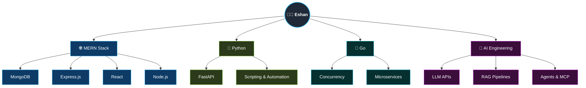

### Hi 👋 I'm Eshan

Fullstack Software Engineer building enterprise banking systems with **MERN** & **Go** — now going deep on **Applied AI Engineering** (LLMs, RAG, Agents, MCP).

- 🏦 Building frontend & backend modules on a Unified Payments Platform serving enterprise banking clients
- 🐍 Comfortable across **JavaScript/TypeScript, Python & Go**
- 🤖 Currently deep in a 100-day Applied AI Engineering curriculum — RAG pipelines, agentic workflows, LLM APIs
- 🎓 VJTI grad
- ⚡ I like moving fast from concept → working project

📫 Reach me: eone84424@gmail.com
